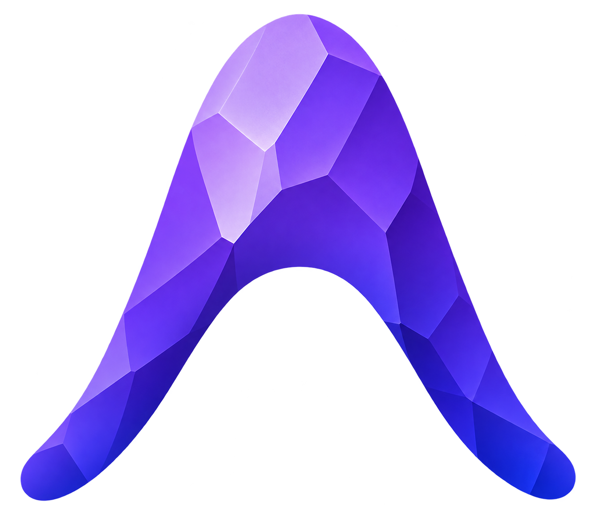

<p align="center">
  
</p>

# Antidian

**Antigravity for Obsidian.** Antidian brings Google's Antigravity agent into your vault, powered by the official **Antigravity CLI (`agy`)**.

Chat with your notes, and let the agent read, write, and edit them with you. It works with the vault you already have, and edits can be reviewed and undone.

## Install

**Requirements**: Obsidian Desktop `1.7.2+` and a Google account.

1. [Open Antidian in Obsidian](obsidian://show-plugin?id=antidian), then install and enable it. If the link is not clickable, paste this into your browser:
   ```text
   obsidian://show-plugin?id=antidian
   ```
2. Open the sidebar from the ribbon icon or run `Antidian: Open sidebar`.
3. Click **Sign in with Google** there, or in **Settings → Antidian**. The `agy` backend is downloaded first if it is missing.

## How It Works

Antidian runs `agy` in the background and talks to it over the **Agent Client Protocol (ACP)**:

- **From `agy`**: the agent itself, along with its models, conversations, slash commands, and skills.
- **From Antidian**: its own **MCP server**, which gives the agent tools to search, read, and edit your vault through Obsidian, plus the chat interface and edit review.

## Privacy & Network Use

- **Google account & AI requests**: Antidian authenticates with your Google account and sends your prompts, attached media, and the notes and files accessed during a conversation to Google's Antigravity backend via the `agy` CLI. It never uploads your entire vault.
- **Backend binary**: If `agy` is not already installed, Antidian downloads and verifies the official Antigravity CLI binary from Google's release endpoint (or you can provide a local binary path in **Settings → Antidian → Advanced**).
- **No telemetry**: Antidian has no analytics of its own. The only server it runs is the MCP server, which listens on `127.0.0.1` and requires a bearer token.

### Coming from Anti-dian

Up to 1.0.1 the plugin was listed as Anti-dian (id `anti-dian`). Obsidian treats the new id as a separate plugin:

1. Install and enable Antidian. It imports your Anti-dian settings on first start and keeps showing your conversations.
2. Disable and uninstall Anti-dian, then reopen the sidebar. Custom hotkeys have to be assigned again.

### Why it needs these permissions

Antidian drives a local agent process, so Obsidian's automated review lists these capabilities on the plugin page:

- **Shell execution** (`child_process`): starts the `agy` binary directly, without a shell, and runs `tar` to unpack its download. The agent gets no shell: its requests to run commands are rejected, and vault access goes through the MCP server. The agent's built-in file tools are refused too, except reading skill files inside `<vault>/.agents/skills/<skill>/` and `~/.agents/skills/<skill>/`.
- **Filesystem access outside the vault** (`fs`): installs and updates `agy` in `~/.gemini/bin`, reads and deletes this plugin's conversations and logs under `~/.gemini`, and reads a certificate file you configure or files you attach by pasting or dropping.
- **Vault enumeration**: lists files so the agent can search your vault and you can `@`-mention notes. Searching happens locally; only the results the agent asked for are sent.
- **Clipboard**: copies a message when you press its copy button, and reads copied file paths when you paste into the prompt.

## Development

See [ARCHITECTURE.md](./ARCHITECTURE.md) for how it works and how to build it, and [AGENTS.md](./AGENTS.md) for contributor guidelines.
